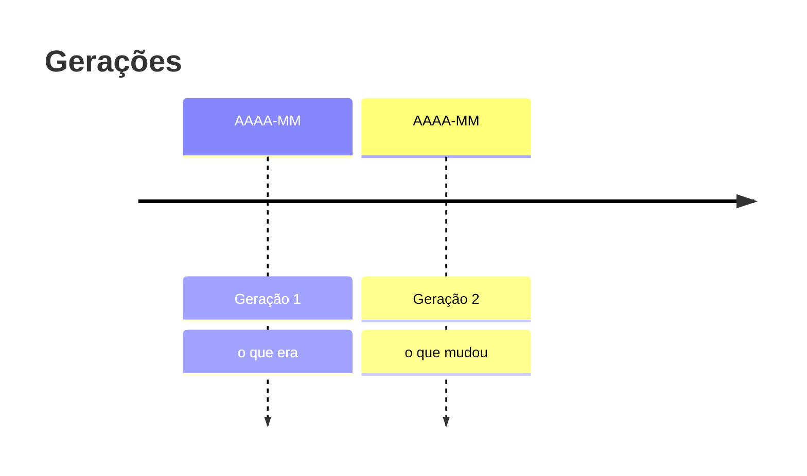
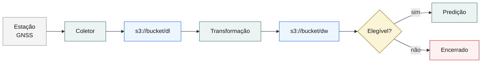
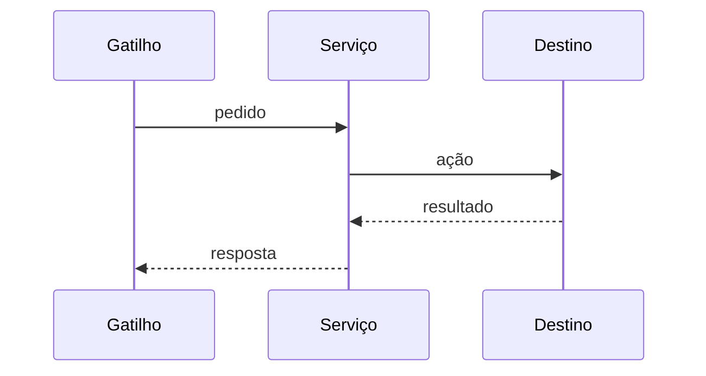

# Título do relatório

<!-- pdf-meta subtitle="Uma frase que diz o que o documento cobre, para a capa" version="1.0" date="DD de mês de AAAA" -->

| Identificação do documento |                                                                                                                                                |
| -------------------------- | ---------------------------------------------------------------------------------------------------------------------------------------------- |
| Tipo                       | Relatório técnico                                                                                                                              |
| Projeto                    | NORTE-ITAIPU — Núcleo de Referência em Tecnologias Espaciais                                                                                   |
| Ciclo                      | Fase e ciclo a que o trabalho pertence                                                                                                         |
| Versão                     | 1.0                                                                                                                                            |
| Data                       | DD de mês de AAAA                                                                                                                              |
| Situação                   | Em vigor. Descreve o sistema como está implantado nesta data                                                                                   |
| Classificação              | Interno, publicável. Não contém segredos, credenciais, identificadores de conta, ARNs completos, endereços IP nem identificadores de instância |
| Público                    | Engenheiros e pesquisadores sem conhecimento prévio do projeto; coordenação, que decide sobre custo, risco e validade                          |
| Responsável                | NORTE, equipe de engenharia                                                                                                                    |
| Fonte                      | `relatorios/<ASSUNTO>.md`; o PDF é gerado a partir do Markdown por `render/render.mjs`                                                         |

| Versão | Data       | Alterações      |
| ------ | ---------- | --------------- |
| 1.0    | AAAA-MM-DD | Primeira edição |

---

## 1. Sumário executivo

### 1.1 Situação

O problema, com o efeito medido sobre o dado, o resultado, o custo ou o risco. Sem histórico aqui: o histórico é a seção 4.

### 1.2 Decisão

O que foi implantado, em dois parágrafos. O primeiro descreve o mecanismo; o segundo, o que ele substitui.

### 1.3 Resultados

| Indicador          | Antes | Depois | Fonte e período     |
| ------------------ | ----- | ------ | ------------------- |
| Indicador medido 1 |       |        | §9.1, DD–DD/MM/AAAA |
| Indicador medido 2 |       |        |                     |

### 1.4 Princípios que sustentam o desenho

Lista curta. Cada princípio é uma regra que uma alteração futura pode violar e que a seção 9.4 protege.

### 1.5 Decisões pendentes do responsável

O que ficou por executar fora do repositório (uma permissão, um segredo a revogar, uma máquina a ligar), com o comando e a ordem.

## 2. Escopo, público e convenções

### 2.1 Escopo

O que o documento cobre. O que não cobre, com o documento que cobre.

### 2.2 Convenções

Unidades (TECU, TECU/min, m, min, GB), fuso (UTC), formato de data (AAAA-MM-DD) e de dia do ano (DOY, três dígitos), código de estação (quatro letras maiúsculas), moeda e data de referência de preços, idioma dos identificadores, o que `código` significa no texto.

## 3. Contexto, restrições e requisitos

### 3.1 Ambiente

Estações, receptores, contas de nuvem, hosts, limites contratuais, o que já existia.

### 3.2 Requisitos de qualidade

| #    | Requisito                          | Verificação                         | Atendido em |
| ---- | ---------------------------------- | ----------------------------------- | ----------- |
| RQ-1 | Uma frase, verificável, com número | O comando ou o teste que o comprova | §9.4        |

### 3.3 Como reconhecer o problema

Sintomas observáveis, com o lugar onde aparecem.

## 4. Histórico e lições

_Seção opcional. Entra quando há gerações anteriores ou um incidente a registrar._

### 4.1 Linha do tempo

_Figura 1 — O que a linha do tempo mostra e o que se conclui dela._

### 4.2 Post-mortem

Impacto, causa raiz, gatilho, o que funcionou, o que faltou, ações com dono. Formato do SRE Book, cap. 15. Sem culpa.

## 5. Arquitetura da solução

### 5.1 Contexto

_Figura 2 — Diagrama de contexto. As seis classes da paleta, para copiar; apagar as que o diagrama não usa._

### 5.2 Componentes

Um subtítulo por componente com responsabilidade, configuração relevante e o que o distingue das alternativas.

### 5.3 Alternativas consideradas

| Alternativa | Motivo da rejeição | Data |
| ----------- | ------------------ | ---- |

## 6. Dados: origem, cobertura e preparo

_Obrigatória quando o relatório trata de dado. Roteiro condensado de Datasheets for Datasets (guia §11.3)._

### 6.1 Origem e motivação

Que fenômeno o dado mede, quem opera a fonte, por que este conjunto e não outro.

### 6.2 Composição e cobertura

| Estação | Período (UTC)           | Cadência | Amostras esperadas | Amostras existentes | Cobertura | Causa da lacuna |
| ------- | ----------------------- | -------- | ------------------ | ------------------- | --------- | --------------- |
| `XXXX`  | AAAA-MM-DD a AAAA-MM-DD | 1 min    |                    |                     | %         |                 |

Formato de origem e versão (RINEX 3.05, RINEX 4.02, CSV do binário). Volume em GB. Identificador e localização do conjunto; condição de acesso.

### 6.3 Preparo

Cada transformação aplicada, na ordem, com o código que a executa: filtro de elevação, descarte de arco curto, agregação temporal e a janela usada, preenchimento de lacuna (ou a decisão de não preencher), unidade de saída. Uma transformação sem código citado não é reproduzível.

### 6.4 Usos e limites do conjunto

Para que o conjunto serve, para que não serve, o que muda se a fonte for revisada ou re-processada.

## 7. Comportamento em execução

### 7.1 Ciclo de vida de uma unidade de trabalho

_Figura 3 — A sequência de uma operação típica, do gatilho ao estado final._

### 7.2 Inventário

Tabela do que existe (jobs, recursos, rotas, caminhos do data lake), com o atributo que importa para a operação.

### 7.3 Entrega e implantação

_Subseção opcional._ Como o artefato chega ao host que o executa; portões, tetos, rollback, o que roda onde.

## 8. Modelo e avaliação

_Obrigatória quando o relatório trata de modelo. Roteiro condensado de Model Cards (guia §11.3)._

### 8.1 Uso pretendido

O que o modelo prevê, com que horizonte, para quem e para que decisão. Usos desaconselhados.

### 8.2 Entradas e alvo

| Variável | Origem | Unidade | Transformação | Defasagem |
| -------- | ------ | ------- | ------------- | --------- |

Alvo, unidade e horizonte de previsão.

### 8.3 Partição e protocolo

Partição **temporal**, com a data de corte declarada. Nenhuma estatística (média, escala, seleção de variável) calculada sobre o conjunto inteiro antes da partição. Número de execuções e sementes. Validação usada e por quê.

### 8.4 Métricas

| Métrica | Linha de base | Modelo | Dispersão entre execuções | Partição |
| ------- | ------------- | ------ | ------------------------- | -------- |

A linha de base é declarada, não implícita: persistência, média móvel ou o modelo anterior em produção.

### 8.5 Desempenho desagregado

Por estação e por horizonte. Uma média que esconde uma estação ruim não serve para operar.

### 8.6 Limites

Onde o modelo erra mais e o que se sabe sobre a causa. Condições fora do domínio de treino (tempestade geomagnética, lacuna longa, estação nova).

## 9. Reprodutibilidade

### 9.1 Ambiente e versões

| Item         | Versão                                           | Como obter |
| ------------ | ------------------------------------------------ | ---------- |
| Código       | commit `abcdef0`                                 |            |
| Python       |                                                  |            |
| Dependências | arquivo de trava (`uv.lock`, `requirements.txt`) |            |
| Dados        | identificador e data do instantâneo              |            |
| Hardware     | CPU/GPU usados na execução medida                |            |

### 9.2 Comandos

Os comandos exatos que reproduzem os números do corpo, em diretório limpo, na ordem. Sementes declaradas.

### 9.3 Artefatos

Onde estão o modelo treinado, as métricas em JSON e os dados brutos de ensaio. Grau de disponibilidade, no vocabulário da ACM: artefato disponível, avaliado ou resultado reproduzido (guia §11.3).

### 9.4 Guardas e invariantes

Testes e verificações que impedem regressão do desenho, com o arquivo de cada um e o que cada um trava.

## 10. Operação (runbook)

### 10.1 Sintoma → verificação → ação

| Sintoma | Verificação (comando de leitura) | Ação |
| ------- | -------------------------------- | ---- |

### 10.2 Comandos de inspeção

Comandos reproduzíveis, só de leitura, com o que a saída deve mostrar.

## 11. Custo e capacidade

### 11.1 Preços de referência (região, mês e ano)

Tabela com URL e data da consulta.

### 11.2 Modelo de custo

A fórmula, com as variáveis nomeadas.

### 11.3 Medido (período)

Tabela por unidade de custo, com fonte e método. Dados brutos no apêndice.

### 11.4 Projeção

Premissas explícitas; resultado como intervalo quando a premissa é incerta.

## 12. Segurança e conformidade

### 12.1 Controles

| Risco (referência nomeada) | Controle | Onde |
| -------------------------- | -------- | ---- |

### 12.2 Acesso ao dado

Quem lê, quem escreve, com que credencial, por quanto tempo. Dado que não pode sair do projeto e o mecanismo que o impede.

### 12.3 Riscos residuais

| Risco | Probabilidade | Impacto | Mitigação | Dono |
| ----- | ------------- | ------- | --------- | ---- |

## 13. Registro de decisões

| Decisão | Alternativas | Motivo | Data |
| ------- | ------------ | ------ | ---- |

## 14. Estado, limites e evolução

### 14.1 Resolvido nesta versão

### 14.2 Em aberto

| Item | Dono | Critério de conclusão |
| ---- | ---- | --------------------- |

### 14.3 Avaliado e não adotado

| Item | Motivo |
| ---- | ------ |

## 15. Glossário e referências

### 15.1 Glossário

| Termo | Definição |
| ----- | --------- |

### 15.2 Referências

| Referência | Uso | URL |
| ---------- | --- | --- |

## Apêndice A — Trechos de referência

Blocos de configuração citados no corpo, anonimizados.

## Apêndice B — Checklist para replicar

## Apêndice C — Comandos de diagnóstico

## Apêndice D — Dados brutos
